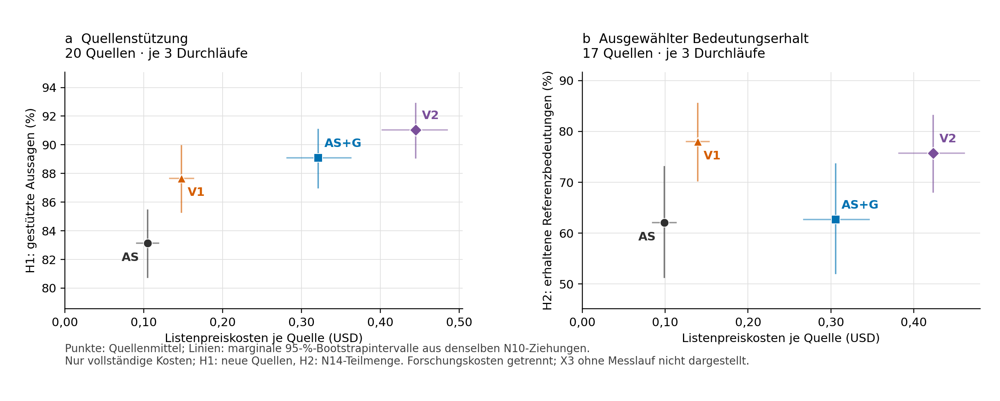

# EF1 – Aufwand und Qualität nach N17 §1

Beschreibende sekundäre Auswertung, Stand 26.10.2026. Keine neuen Modellaufrufe, Tests auf Überlegenheit oder Änderungen der primären D1-Urteile. Geldbeträge sind bekannte archivierte Listenpreiskosten in USD, keine geprüften Rechnungen.

## Population, Nenner und Unsicherheit

H1 verwendet 20 neue Quellen mit vollständigen Kosten aller vier Arme. H2 wird einmal mit der unveränderten konservativen G2-Fehlwertregel auf diesen Quellen und zusätzlich auf den 17 kostenbekannten Quellen mit gültigen Urteilen nach N14 ausgewiesen. Der tatsächliche N14-Bestand umfasst dieselben 17 neuen Quellen. Die übrigen drei neuen und alle vier versiegelten Quellen haben keine gültigen H2-Urteile. Historische Extraktionskosten der versiegelten Quellen sind außerdem unbekannt, keinesfalls null.

Die Rechnung berücksichtigt seit Beginn alle tatsächlich eingefrorenen Durchläufe: NEW20 × 3 und SEALED4 × 2, zusammen 68. Die beim Beginn von EF1 vorliegende, noch nicht committete N17-Arbeitsfassung sprach von „beiden Durchläufen“. Die aktuelle N17-Fassung dokumentiert die Korrektur dieses früheren Wortlauts vor ihrem Commit und verwendet dieselbe eingefrorene Population wie EF1. Die redaktionelle Klarstellung ändert keine Berechnung. Kosten je Quelle summieren alle drei neuen Durchläufe und sind keine Kosten je einzelnem Durchlauf.

H1 schätzt je Quelle die vollständige Aussagezahl multipliziert mit ihrem gepoolten N10-Stützungsanteil. Erst danach werden die geschätzten Anzahlen summiert. H2 multipliziert die Zahl der einmal pro Quelle festgelegten Referenzbedeutungen mit dem quellenweisen H2-Wert. H2 bezeichnet ausgewählten Bedeutungserhalt, keinen vollständigen Quellenrecall.

Alle 10.000 zweistufigen N10-Ziehungen werden wörtlich wiederverwendet, einschließlich der ursprünglichen globalen Sechsergruppen und des G2-Seeds 2026102407. Matrix: `e88daf8592fbf987e03cf9fc51642e462db9e142f788046dac0b3b8936235b76`. Die vorher festgelegten kostenbekannten Teilmengen werden in jede unveränderte 24-Quellen-Ziehung projiziert. Kosten wandern mit der Quelle; die Anzahl zulässiger Quellen pro Ziehung variiert. Mittelwerte teilen durch diese Anzahl. Die Kennzahlen und AS-Verhältnisse bleiben gepaart. 95-%-Intervalle sind marginale 2,5-/97,5-%-Quantile, ohne zusätzlichen Test und ohne Holm-Aussage. Nicht schätzbare Werte oder Replikate werden nicht entfernt; Schranken stehen in `result.json`. N10s nur näherungsweise gleiche Inklusionswahrscheinlichkeiten bleiben eine Einschränkung.

## Kosten und Qualitätswerte je Quelle

| Arm | Kosten/Quelle USD, H1-Population | H1 % | Kosten/Quelle USD, N14-Teilmenge | H2 % |
| --- | --- | --- | --- | --- |
| AS | 0,1048 [0,0909; 0,1188] | 83,14 [80,74; 85,44] | 0,0991 [0,0852; 0,1133] | 62,08 [51,30; 73,02] |
| AS+G | 0,3211 [0,2817; 0,3624] | 89,10 [87,01; 91,08] | 0,3055 [0,2674; 0,3460] | 62,70 [52,10; 73,60] |
| V1 | 0,1477 [0,1328; 0,1629] | 87,67 [85,30; 89,93] | 0,1391 [0,1256; 0,1532] | 78,01 [70,32; 85,49] |
| V2 | 0,4448 [0,4022; 0,4847] | 91,04 [89,10; 92,88] | 0,4234 [0,3819; 0,4609] | 75,76 [68,07; 83,15] |

Horizontale und vertikale Linien sind marginale Bootstrapintervalle; sie sind keine gemeinsamen Konfidenzregionen und kein Signifikanztest. Verschiedene Marker und direkte Beschriftungen erhalten die Armzuordnung in Graustufen. X3 wird nicht eingezeichnet: Der vorliegende CPU-Projektionscode und seine zusätzlichen Anbietergebühren von null sind kein gemessener unabhängiger VV-Prüffilterlauf.

## H1-bezogene Effizienzmaße auf den 20 neuen Quellen

| Arm | Vollkosten USD | Geschätzte gestützte Aussagen | USD/gestützter Aussage | Gesamttokens/gestützter Aussage | Gestützte Aussagen/1.000 Konstruktionstokens |
| --- | --- | --- | --- | --- | --- |
| AS | 2,0956 [1,6156; 2,5525] | 2 773,2 [2 136,5; 3 378,8] | 0,000756 [0,000711; 0,000806] | 871,1 [816,5; 932,2] | 1,148 [1,073; 1,225] |
| AS+G | 6,4212 [4,9853; 7,8081] | 2 736,4 [2 105,0; 3 335,7] | 0,002347 [0,002224; 0,002483] | 1 849,0 [1 750,7; 1 950,7] | 1,133 [1,057; 1,212] |
| V1 | 2,9540 [2,3258; 3,5325] | 4 060,8 [3 181,7; 4 869,5] | 0,000727 [0,000678; 0,000777] | 843,8 [785,0; 902,5] | 1,185 [1,108; 1,274] |
| V2 | 8,8969 [7,0388; 10,5798] | 3 993,9 [3 126,2; 4 785,5] | 0,002228 [0,002108; 0,002348] | 1 827,8 [1 736,4; 1 910,9] | 1,166 [1,090; 1,254] |

Schätzungen gestützter Aussagen sind keine Vollzählungen. Gesamttokens umfassen gegebenenfalls den Prüffilter. Der Nenner „Konstruktionstokens“ umfasst Extraktion, Ergänzung und Schema, ausdrücklich ohne Prüffilter.

| Arm | USD/gestützt, Verhältnis zu AS | Tokens/gestützt, Verhältnis zu AS | Gestützt/1.000 Konstruktionstokens, Verhältnis zu AS |
| --- | --- | --- | --- |
| AS | 1,000 [1,000; 1,000] | 1,000 [1,000; 1,000] | 1,000 [1,000; 1,000] |
| AS+G | 3,105 [2,968; 3,263] | 2,123 [2,034; 2,216] | 0,987 [0,974; 1,000] |
| V1 | 0,963 [0,887; 1,037] | 0,969 [0,889; 1,048] | 1,032 [0,954; 1,125] |
| V2 | 2,948 [2,708; 3,205] | 2,098 [1,927; 2,270] | 1,015 [0,939; 1,107] |

## H2-bezogene Effizienzmaße

### G2-Regel auf den 20 kostenbekannten neuen Quellen

| Arm | Quellen | Geschätzte erhaltene Referenzbedeutungen | USD/erhaltener Referenzbedeutung | Verhältnis zu AS |
| --- | --- | --- | --- | --- |
| AS | 20 | 97,00 [66,67; 127,33] | 0,0216 [0,0164; 0,0304] | 1,000 [1,000; 1,000] |
| AS+G | 20 | 98,00 [67,67; 128,67] | 0,0655 [0,0496; 0,0923] | 3,033 [2,869; 3,198] |
| V1 | 20 | 122,33 [88,67; 156,33] | 0,0241 [0,0188; 0,0332] | 1,118 [1,015; 1,215] |
| V2 | 20 | 118,67 [85,67; 151,67] | 0,0750 [0,0584; 0,1024] | 3,470 [3,125; 3,837] |

### N14-Analyse 2, Schnittmenge mit vollständigen Kosten

| Arm | Quellen | Geschätzte erhaltene Referenzbedeutungen | USD/erhaltener Referenzbedeutung | Verhältnis zu AS |
| --- | --- | --- | --- | --- |
| AS | 17 | 97,00 [66,67; 127,33] | 0,0174 [0,0143; 0,0210] | 1,000 [1,000; 1,000] |
| AS+G | 17 | 98,00 [67,67; 128,67] | 0,0530 [0,0435; 0,0650] | 3,051 [2,868; 3,247] |
| V1 | 17 | 122,33 [88,67; 156,33] | 0,0193 [0,0166; 0,0223] | 1,113 [1,019; 1,207] |
| V2 | 17 | 118,67 [85,67; 151,67] | 0,0607 [0,0518; 0,0708] | 3,492 [3,138; 3,892] |

## AS+G gegen V1: keine reine Aufwandserklärung

Die folgenden Differenzen lauten **V1 minus AS+G** und sind beschreibend, ohne neuen Hypothesentest. Qualitätswerte stammen jeweils aus derselben Population wie ihre Kosten.

| Population | H1-Differenz Prozentpunkte | H2-Differenz Prozentpunkte | Kosten-Differenz USD gesamt |
| --- | --- | --- | --- |
| H1, 20 Quellen | -1,43 [-4,79; 1,75] | 13,02 [6,92; 19,61] | -3,4672 [-4,3813; -2,5808] |
| N14, 17 Quellen | -1,92 [-5,72; 1,75] | 15,31 [8,56; 22,40] | -2,8283 [-3,7551; -1,9148] |

Die unterschiedliche Aufgabenverteilung und der verschiedene Aussagebestand bleiben mit dem Aufwand verbunden. Es fehlt ein rechenaufwandsgleicher AutoSchemaKG-Vergleich. Weder die Erklärung „nur mehr Rechnen“ noch ein isolierter Architektureffekt ist damit kausal nachgewiesen.

## Aufteilung nach Stufe und Forschungsaufwand

Diese Tabelle zählt originale physische Belegidentitäten disjunkt. AS+G nutzt die bei AS gebuchte Grundkonstruktion weiter, V2 die bei V1 gebuchte. Vollkostenvergleiche der vier logischen Arme enthalten diese Grundkosten jeweils, die physischen Gesamtsummen zählen sie einmal. Holds und Reserven werden nicht zu Kosten addiert.

| Arm | Stufe | Aufrufe | Eingabetokens | Ausgabetokens | USD | Summe Anfragedauer s |
| --- | --- | --- | --- | --- | --- | --- |
| AS | Extraktion | 180 | 167 154 | 138 520 | 0,431208 | unbekannt (Teilsumme) |
| AS | Schema | 6 064 | 2 040 552 | 69 541 | 1,664389 | unbekannt (Teilsumme) |
| V1 | Ergänzung | 60 | 196 266 | 59 493 | 0,277311 | unbekannt (Teilsumme) |
| V1 | Extraktion | 180 | 181 254 | 132 474 | 0,428220 | unbekannt (Teilsumme) |
| V1 | Schema | 7 961 | 2 766 026 | 90 822 | 2,248484 | unbekannt (Teilsumme) |
| AS+G | Prüffilter | 233 | 1 802 951 | 840 967 | 4,325606 | 7 469,33 |
| V2 | Prüffilter | 294 | 2 778 496 | 1 095 091 | 5,942845 | 9 770,51 |

Die Summe einzelner protokollierter Anfragedauern ist **keine Wandzeit**, insbesondere bei Parallelität. Isolierte Wandzeiten der Konstruktionsstufen sind nicht vollständig belegt und bleiben unbekannt. Fehlende Konstruktordauern wurden nicht durch einen erneuten Massenscan rekonstruiert; vorhandene abgeschlossene Kostenbelege bleiben maßgeblich.

Der deterministische CPU-Export steht separat unter `stages.json/CPU_export_separate`: C5 belegt 544 Exportzellen für alle 24 Quellen, vier Arme und beide Exportformen, ohne zusätzliche Modellaufrufe. Eine isolierte CPU-Kosten- oder Wandzeitmessung liegt im gebundenen Abschluss nicht vor. Dieser Aufwand ist nicht als kostenloser Gesamtprozess interpretiert und nicht als LLM-Bewertungsaufwand gebucht.

Alle Forschungspakete mit Aufrufen, Tokens, Kosten, Währung, Preisszenario und Zeitvollständigkeit stehen vollständig in `stages.json`. C6-Reader und Zugangsprobe, T1 als andere Konstruktormodellbedingung sowie C2/C3, Referenzerstellung und Qualifikationen werden nicht in N17-Konstruktionskosten eingerechnet. EUR und USD bleiben getrennt. C1-MuSiQue kostet 51,68097936 USD bei 3.854 Aufrufen; der Ledger-Gesamtwert 62,82758736 USD enthält zusätzlich 11,14660800 USD Konfirmation. T1: 7.656 Aufrufe, 6,14850118 USD, bislang kein gemeinsamer semantischer Qualitätsvergleich. C6: 0,15451260 USD Reader plus getrennte 0,00002706 USD Zugangsprobe. Seine HTTP- und Workerzeitsummen sind keine gesamte Laufwandzeit.

## Vollständigkeit und Grenzen

Über alle 24 Quellen sind die Gesamtkosten wegen der historischen Extraktion der vier versiegelten Quellen unbekannt. `result.json/full24_cost_scope` nennt deshalb nur bekannte Kostenuntergrenzen und untersagt Vergleichsaussagen daraus. Die vollständigen Effizienzkontraste beschränken sich auf die oben genannten kostenbekannten Populationen. Fehlende historische Kosten sind kein Nachteil eines Arms und kein Nullwert. Qualität und Kosten werden nicht zu einem gemeinsamen Gesamtscore verdichtet.

K2 wurde aus Originalbelegen ergänzt: sämtliche Prüffilteraufrufe erhalten eine Quelle; leere Aufrufmengen bleiben als Nicht-Aufrufe gekennzeichnet und erhalten eine gruppenspezifische Belegidentität. Ursprüngliche Antworten, Ausführungsledger und der primäre D1-Ergebnisstand bleiben unverändert. Verifikation und genaue K2-Reparaturbelege stehen in den K2-Dateien und `verification.json`.
